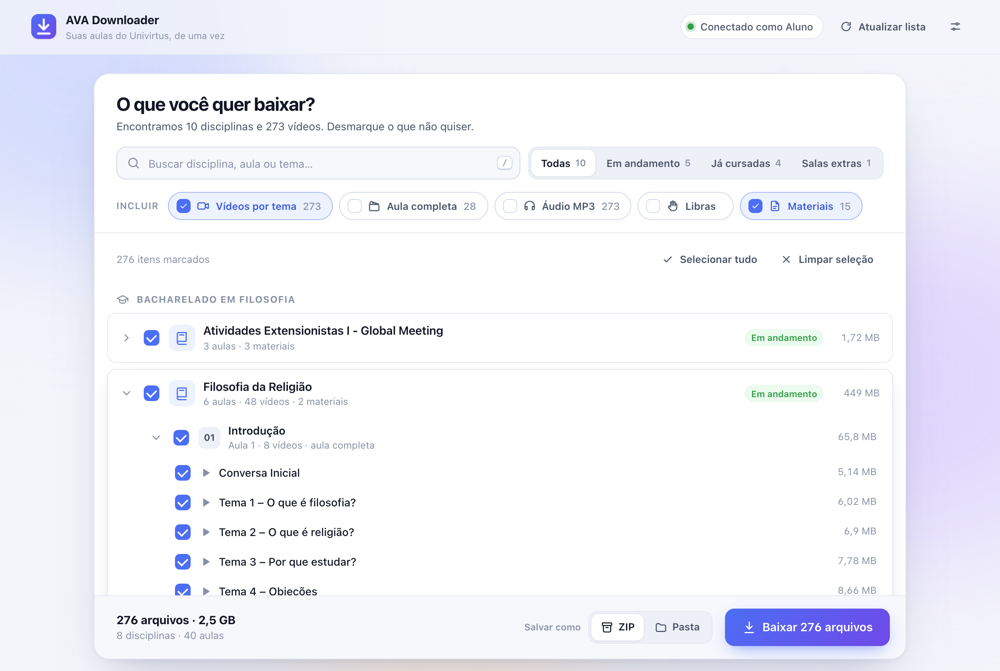
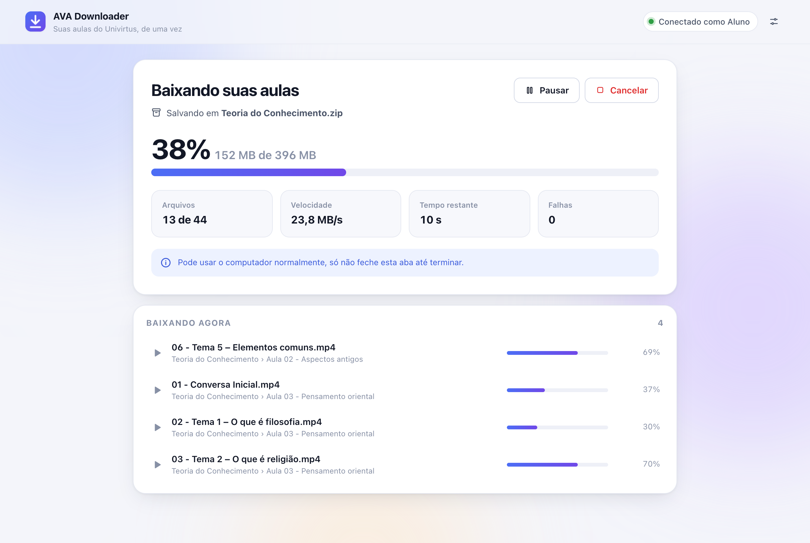

# AVA Downloader

Extensão para Google Chrome (e Microsoft Edge) que baixa **de uma vez** as videoaulas e os materiais do **AVA Univirtus (Uninter)**, já organizados por curso, disciplina e aula. Você pode baixar tudo num **arquivo ZIP** ou numa **pasta**.

> Extensão não oficial, feita por alunos para uso pessoal. Ela usa a sua própria conta do AVA e não envia nada para nenhum outro lugar.



## O que ela faz

- Lê todas as suas disciplinas direto da API do AVA. Leva poucos segundos e não precisa clicar aula por aula.
- Abre uma tela para você escolher o que baixar: disciplinas, aulas ou temas, com **busca** e filtro (em andamento, já cursadas…).
- Baixa vários arquivos ao mesmo tempo, com barra de progresso, velocidade e tempo restante.
- Dá para **pausar e continuar**. Se a internet cair, ela continua de onde parou.
- Organiza tudo assim:

```
Bacharelado em Filosofia/
  Filosofia da Religião/
    Aula 01 - Introdução à Filosofia da Religião/
      01 - Conversa Inicial.mp4
      02 - Tema 1 – O que é filosofia.mp4
      …
      08 - Finalizando.mp4
      Áudio/01 - Conversa Inicial.mp3        (se marcar “Áudio MP3”)
      Materiais/…pdf
    Material complementar/
      Plano de ensino - FILOSOFIA DA RELIGIAO.pdf
Assistir aulas.html                         ← abra este arquivo
```

- Cria o arquivo **`Assistir aulas.html`**: uma página que mostra tudo organizado e toca as aulas direto da pasta, **mesmo sem internet**.



## Como instalar (5 minutos, só na primeira vez)

1. Nesta página do GitHub, clique no botão verde **`Code`** → **`Download ZIP`**. Abra (descompacte) o arquivo baixado.
2. No Chrome, digite na barra de endereço: **`chrome://extensions`** e aperte Enter.
   (No Edge: **`edge://extensions`**.)
3. Ligue o **Modo do desenvolvedor**, no canto superior direito.
4. Clique em **Carregar sem compactação** e escolha a pasta **`extension`**, que fica dentro da pasta que você descompactou.
5. Clique no ícone de quebra-cabeça 🧩 ao lado da barra de endereço e no alfinete 📌 do **AVA Downloader**, para o ícone ficar sempre visível.

Pronto. Não apague nem mova a pasta depois de instalar: o Chrome usa a extensão direto dela.

## Como usar

1. Abra o **AVA** e entre com seu RU e senha, como sempre.
2. Clique no botão **Baixar aulas** (canto inferior direito do AVA) ou no ícone da extensão.
3. Tudo já vem marcado. Desmarque o que não quiser, ou use a busca para achar uma aula ou tema.
4. Em **Incluir**, escolha o tipo de conteúdo:
   | Opção | O que é |
   |---|---|
   | **Vídeos por tema** | Cada tema da aula em um vídeo (Conversa inicial, Tema 1, Tema 2…). Vem marcado. |
   | **Aula completa** | A aula inteira em um vídeo só. É a junção dos temas, então ocupa o mesmo espaço **de novo**. |
   | **Áudio MP3** | Só o áudio, ótimo para ouvir no celular. |
   | **Libras** | Vídeos com intérprete de Libras, quando a aula tiver. |
   | **Materiais** | PDFs, apostilas e arquivos das aulas e do material complementar. |
5. Em **Salvar como**, escolha:
   - **ZIP**: um arquivo único, fácil de guardar ou mandar para alguém.
   - **Pasta**: melhor para downloads grandes. Se você baixar de novo na mesma pasta, ela **só baixa o que falta**. Ótimo para baixar as aulas novas no meio do semestre.
6. Clique em **Baixar** e escolha onde salvar. Deixe a aba aberta até terminar (pode usar o computador normalmente).

## Perguntas frequentes

**É seguro? Ela pega minha senha?**
Não. A extensão não vê nem guarda sua senha. Ela só funciona enquanto você está logado no AVA, usando a mesma sessão do navegador. Os vídeos vêm direto dos servidores da Uninter para o seu computador.

**Quanto espaço vou precisar?**
O tamanho aparece embaixo, antes de baixar. Uma disciplina com 6 aulas costuma ter de 300 a 600 MB só com os vídeos por tema.

**Posso fechar o navegador no meio?**
Não feche a aba da extensão até terminar. Se precisar parar, use **Pausar**. No modo **Pasta**, mesmo que feche, é só baixar de novo na mesma pasta: o que já foi baixado é pulado.

**Apareceu “Entre no AVA para continuar”.**
Abra o AVA e faça login. A extensão percebe sozinha e continua.

**Alguns arquivos falharam.**
Clique em **Tentar de novo os que falharam**. No ZIP, a lista dos que falharam fica no arquivo `LEIA-ME - arquivos com erro.txt`.

**Vídeos do YouTube e aulas ao vivo**
Esses não são baixados. Eles aparecem como links dentro da aula.

**Uso responsável**
O conteúdo das aulas pertence à Uninter e aos professores. Use os arquivos só para os seus estudos e não redistribua.

---

## Para desenvolvedores

Sem build e sem dependências: a extensão é JavaScript puro (ES modules) em `extension/`.

```bash
npm test          # testes (ZIP validado com Python/unzip/ditto, retomada com Range, pausa, catálogo)
npm run preview   # interface com dados fictícios: http://127.0.0.1:8765/app/preview.html
```

Como funciona:

| Peça | Arquivo |
|---|---|
| Ponte com a API do AVA (cookie + cabeçalho `X-time` da aba logada) e botão flutuante | `extension/content/content.js` |
| Leitura do catálogo (cursos → disciplinas → aulas → vídeos/materiais) | `extension/app/lib/catalog.js` |
| Plano de pastas e nomes de arquivos | `extension/app/lib/plan.js`, `naming.js` |
| Fila de download (paralela, pausa, Range, novas tentativas) e destinos ZIP/Pasta | `extension/app/lib/downloader.js` |
| ZIP com ZIP64 gravado direto no disco, em paralelo | `extension/app/lib/zip.js`, `crc32.js` |
| Página offline “Assistir aulas.html” | `extension/app/lib/offline-index.js` |
| Interface | `extension/app/app.html`, `app.css`, `app.js` |

Detalhes da API do AVA e regras do projeto: [AGENTS.md](AGENTS.md).
